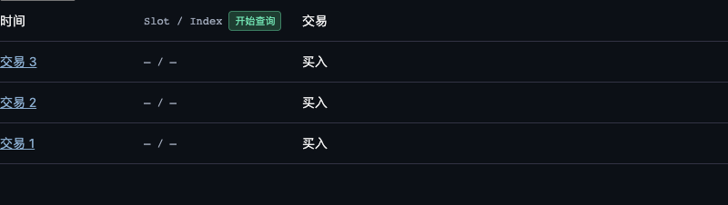
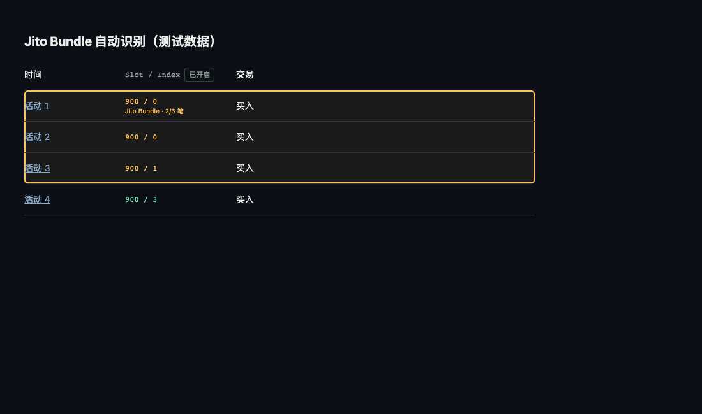
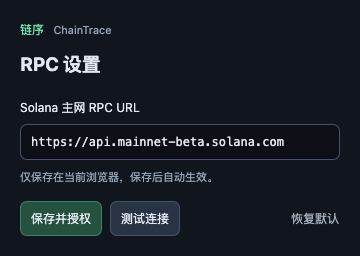

# 链序 ChainTrace

[](https://github.com/hexf11/ChainTrace/actions/workflows/ci.yml)
[](LICENSE)
[](https://github.com/hexf11/ChainTrace/releases/latest)

**在 GMGN 活动列表中，自动查看 Solana 交易顺序与已核验的 Jito Bundle。**

A lightweight Chrome extension for automatic Solana Slot / Index lookup and verified Jito bundle highlighting on GMGN.

## 功能

- **点击开启**：进页面默认不查询，排好序后点击 `Slot / Index` 旁的「开始查询」，再按当前顺序自动查询和滚动补查。
- **K 线联动**：开启查询后点击 1s K 线，自动定位、突出显示并查询该秒的活动。
- **同笔分组**：Slot 和 Index 都相同的多条活动用同色框线标为「同笔」。
- **Jito Bundle**：核对 Jito 归属、完整成员和区块顺序后，仅在当前活动列表可见至少两笔不同交易时画金色框；点击可查看官方来源。
- **精简设置**：点击工具栏图标，只显示 RPC 地址、保存、测试连接和恢复默认。
- **只读运行**：不连接钱包、不签名、不发送交易，无遥测，无运行时第三方依赖。

### 活动列表



先调整活动列表排序，再点击标题旁的「开始查询」。刷新或切换代币后重新等待点击。



上图为浏览器测试数据。`2/3 笔` 表示当前列表可见 2 笔交易，该 bundle 共有 3 笔。

### RPC 设置



## 安装

需要 **Chrome 111+**。

1. 下载 [最新安装包 chaintrace-chrome.zip](https://github.com/hexf11/ChainTrace/releases/latest/download/chaintrace-chrome.zip) 并解压。
2. 打开 `chrome://extensions`，开启右上角「开发者模式」。
3. 点击「加载已解压的扩展程序」，选择包含 `manifest.json` 的 `chaintrace-chrome` 文件夹。
4. 刷新 GMGN 的 Solana 代币详情页，调整活动列表排序，再点击 `Slot / Index` 旁的「开始查询」。
5. 将链序固定到工具栏，点击图标即可设置自己的主网 RPC。

也可以克隆源码后直接加载仓库根目录，无需构建：

```sh
git clone https://github.com/hexf11/ChainTrace.git
```

请保留扩展所在的文件夹。更新时覆盖同一目录中的文件，在扩展管理页点击刷新，再刷新 GMGN。
继续使用同一安装路径可保留 RPC 设置。[详细安装说明](docs/INSTALL.md)

## 使用说明

Slot 是区块所在的槽位，Index 是交易在完整区块中的原始位置，**从 0 开始**。
查询使用已最终确认的数据，因此新交易可能需要稍等。失败查询会自动退避重试。

每个页面初始都等待点击，不发送 RPC 或 Jito 索引查询。开启后按钮显示「已开启」，
列表更新、滚动和 K 线联动继续自动查询。刷新页面或切换代币会重置为等待状态，
开始状态不跨页面保存；修改 RPC 设置不会自动开启尚未开始的页面。

默认公共 RPC 可能限流或不支持历史查询；自定义主网节点需支持 `getGenesisHash`、
`getSignatureStatuses`、`getTransaction` 和 `getBlock`。RPC 设置保存后自动应用到已打开的页面。

「同笔」表示同一笔链上交易的多条活动记录。Jito Bundle 的确认依据是公开索引和完整成员核验，
并且当前活动列表必须可见至少两笔不同签名的交易才画框。单笔 Jito 提交不标记；
普通交易加独立 tip、同一交易的重复活动都不凑成两笔活动。仅显示一笔成员时，`1/2`、`1/3` 等也不画框，
出现第二笔不同活动后再自动显示。包内总笔数可能包含独立 tip，标记不判断钱包关联或交易意图。

不会用相同 Slot、相邻 Index 或 tip 转账代替归属证据。索引可能延迟或缺少记录，也不覆盖全部私有或其他服务的 bundle。
**没有标记可能是证据不足或当前可见成员不足，不表示一定没有 bundle。**

## 权限与数据

扩展只在 GMGN 顶层页面注入。RPC 地址保存在当前浏览器的扩展存储中，不做云同步，完整地址不转发到 GMGN 页面。
后台仅允许四种只读 RPC 方法。自定义节点在保存时按域名请求访问权限。
RPC 提供商会收到查询签名和区块号，Jito 索引只收到区块号；请求不携带浏览器 Cookie。

[架构与权限说明](docs/ARCHITECTURE.md) · [安全问题反馈](SECURITY.md)

## 开发与验证

需要 Node.js 22+、npm 和 Python 3。运行时无需 Node.js 或 Python。

```sh
npm ci
npx playwright install chromium
npm run check
npm test
npm run test:browser
npm run package
```

Linux CI 使用 `npx playwright install --with-deps chromium`。
浏览器测试通过独立临时配置加载真实扩展，使用 GMGN、RPC 与 Jito 测试夹具，不读取个人浏览器配置。
测试覆盖点击前零请求、按当前排序启动、切换代币后停止旧重试、滚动和虚拟列表、K 线联动、RPC 切换、同笔分组及 bundle 核验。
GMGN 的页面结构和图表接口可能变化；夹具测试不代表已覆盖所有线上页面或节点。

打包产物为 `dist/chaintrace-chrome.zip` 和 `dist/SHA256SUMS`。
安装包使用固定文件清单和时间戳，同一输入可重复生成相同 ZIP。

[参与贡献](CONTRIBUTING.md) · [更新记录](CHANGELOG.md)

## 许可证

[MIT](LICENSE) © 2026 hexf11 and ChainTrace contributors.

ChainTrace 是独立开源项目，与 GMGN、Solana 或 Jito 无隶属关系。
